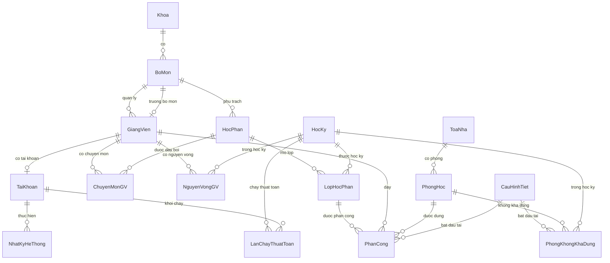

# Hệ thống hỗ trợ quản lý và phân công giảng dạy (UCTP) — Hướng dẫn cấu trúc dự án

Stack đề xuất: **Django + Django REST Framework** (backend) — **SQL Server** (CSDL) — **React** (frontend). Ghi chú tương thích FastAPI được để riêng ở cuối file cho từng phần liên quan.

---

## 1. Sơ đồ quan hệ thực thể (ERD)



> **Lưu ý về `CauHinhTiet`**: bảng này chứa giờ bắt đầu/kết thúc từng tiết học, seed sẵn theo mốc đã xác nhận từ trang "Thời gian biểu các ca học" — Khoa Giáo dục, Trường Đại học Sài Gòn (tiết 1 bắt đầu 7h00, mỗi tiết 50 phút, tiết cuối ca 3 kết thúc 20h10). Phần giờ nghỉ giữa các tiết/ca còn lại là **ước lượng theo quy ước phổ biến**, vì trang gốc hiển thị bảng dưới dạng ảnh nên không trích xuất được chính xác từng phút — **cần đối chiếu lại với Sổ tay sinh viên hoặc Phòng Đào tạo SGU chính thức** trước khi triển khai thật, và chỉnh trực tiếp dữ liệu trong bảng (không cần sửa code, vì toàn bộ hệ thống chỉ tham chiếu đến `MaTiet`, không hard-code giờ ở bất kỳ đâu khác).

> **Quy tắc ưu tiên Ca 1-2 trước, Ca 3 chỉ khi không đủ chỗ**: cột `MucUuTien` (1 = Sáng/Chiều, 2 = Tối) là nơi mã hóa đúng quy tắc này dưới dạng dữ liệu. Khi lớp `adapters.py` sinh danh sách khung giờ khả dĩ cho 1 lớp học phần để đưa vào thuật toán (`class_times`), cần gán **giá trị `penalty` của mỗi khung giờ tỉ lệ theo `MucUuTien`** — ví dụ `penalty = (MucUuTien - 1) * 20`, khiến khung giờ Tối luôn có điểm phạt cao hơn hẳn Sáng/Chiều. Vì đây là **ràng buộc mềm** (không phải cứng cấm), Stage 1 vẫn cho phép chọn Ca 3 khi cần (đảm bảo luôn có nghiệm khả thi), nhưng Stage 2 (tối ưu Soft Penalty) sẽ tự nhiên "đẩy" các lớp sang Sáng/Chiều trước, chỉ giữ ở Ca 3 những lớp thực sự không còn chỗ nào khác — đúng tinh thần "Ca 1-2 trước, hết chỗ mới đến Ca 3" mà không cần thêm ràng buộc cứng riêng biệt (tránh làm bài toán khó giải hơn không cần thiết).

## 2. Giải thích các bảng chính

| Bảng | Vai trò |
|---|---|
| `Khoa`, `BoMon` | Cấu trúc tổ chức — mỗi khoa có nhiều bộ môn, mỗi bộ môn có 1 trưởng bộ môn (là 1 giảng viên) |
| `GiangVien` | Hồ sơ giảng viên, định mức giờ dạy tối thiểu/tối đa (dùng làm ràng buộc mềm/cứng cho thuật toán) |
| `HocPhan`, `LopHocPhan`, `HocKy` | Danh mục học phần, lớp học phần theo từng học kỳ — tương ứng `course`/`class` trong dữ liệu ITC 2019 đã dùng ở phần thuật toán |
| `PhongHoc`, `ToaNha`, `PhongKhongKhaDung` | Danh mục phòng học và các khung giờ phòng không khả dụng (bảo trì...) |
| `CauHinhTiet` | Cấu hình giờ từng tiết học (tham khảo khung giờ SGU) + `MucUuTien` mã hóa quy tắc ưu tiên Ca 1-2 trước, Ca 3 chỉ khi không đủ chỗ — bảng dữ liệu có thể chỉnh sửa, không hard-code trong logic |
| `ChuyenMonGV` | Bảng trung gian n-n: giảng viên nào dạy được học phần nào — **chính là `TeacherCourseCompatibility`** đã dùng ở Stage 0/1 của thuật toán |
| `NguyenVongGV` | Nguyện vọng giờ dạy của giảng viên — dùng làm ràng buộc mềm (Teacher Preference Penalty) ở Stage 2 |
| `PhanCong`, `PhanCongTuan` | Kết quả xếp lịch: một dòng `PhanCong` là một buổi học, các tuần có dạy nằm ở `PhanCongTuan`; không giả định học kỳ luôn 16 tuần. |
| `LopHanhChinh`, `LopHocPhanLopHanhChinh` | Liên kết một nhóm học phần với các lớp hành chính để in cột `Tên lớp` và kiểm tra trùng lịch khi cần. |
| `TaiKhoan` | Đăng nhập hệ thống, phân quyền theo vai trò (Quản trị / Trưởng bộ môn / Giảng viên) |
| `NhatKyHeThong` | Audit log — ghi lại ai sửa gì, khi nào (bắt buộc với hệ thống có phân công tự động, để tra soát khi có khiếu nại) |
| `LanChayThuatToan` | Lưu lại lịch sử mỗi lần chạy thuật toán (Soft Penalty trước/sau, số lần kick...) để đối chiếu và audit — tương ứng bảng `summary_all_instances.csv` đã dùng khi thực nghiệm |

**Lưu ý khi map từ thuật toán sang CSDL**: notebook thực nghiệm dùng `class_id`, `room_id`, `teacher_id` dạng chuỗi tự sinh (`GV_0001`...) — khi tích hợp vào web, các ID này sẽ là khóa chính `INT IDENTITY` thật của CSDL. Cần viết lớp `adapters.py` chuyển đổi hai chiều giữa dữ liệu CSDL và cấu trúc `class_times`/`class_rooms`/`class_candidates`. Các hàm `generate_teachers`, `repair_teacher_feasibility` và `repair_global_iterative` chỉ phục vụ thí nghiệm với dữ liệu giả lập; tuyệt đối không gọi chúng trên dữ liệu giảng viên thật. Nếu thiếu giảng viên phù hợp, trả về lớp chưa phân công cùng nguyên nhân để người quản lý xử lý.

Riêng phần **thời gian**, thuật toán dùng đơn vị "slot" kiểu ITC 2019 (0-287, mỗi slot 5 phút trong ngày), còn CSDL dùng `MaTietBatDau` (số tiết theo `CauHinhTiet`). Adapter cần quy đổi 2 chiều: `slot = (giờ × 60 + phút) / 5` khi đưa dữ liệu vào thuật toán, và ngược lại tra `CauHinhTiet` theo khoảng `GioBatDau`/`GioKetThuc` gần nhất để suy ra `MaTietBatDau` khi ghi kết quả (`best_sol`) trở lại bảng `PhanCong`.

---

## 3. Cấu trúc thư mục dự án

```
uctp_web/
│
├── backend/
│   │
│   ├── manage.py
│   ├── requirements.txt
│   ├── .env.example
│   │
│   ├── config/                      # Cau hinh du an Django (khong chua nghiep vu)
│   │   ├── settings.py              # Ket noi SQL Server, cai dat chung
│   │   ├── urls.py                  # Tong hop route cua tat ca app
│   │   └── asgi.py / wsgi.py
│   │
│   ├── apps/
│   │   │
│   │   ├── accounts/                # Dang nhap, phan quyen, tai khoan
│   │   │   ├── models.py            # TaiKhoan
│   │   │   ├── serializers.py
│   │   │   ├── views.py             # API dang nhap/dang xuat/doi mat khau
│   │   │   └── permissions.py       # Phan quyen theo VaiTro
│   │   │
│   │   ├── catalog/                 # Danh muc: Khoa, BoMon, GiangVien, HocPhan, PhongHoc, HocKy
│   │   │   ├── models.py
│   │   │   ├── serializers.py
│   │   │   ├── views.py             # CRUD danh muc
│   │   │   └── admin.py             # Dang ky Django Admin (quan tri nhanh khong can code UI)
│   │   │
│   │   ├── scheduling/              # Nghiep vu chinh: LopHocPhan, ChuyenMonGV, NguyenVongGV, PhanCong
│   │   │   ├── models.py
│   │   │   ├── serializers.py
│   │   │   ├── views.py             # API xem/sua thoi khoa bieu, duyet phan cong
│   │   │   └── validators.py        # Kiem tra rang buoc thu cong (trung lich...) khi sua tay
│   │   │
│   │   ├── algorithm/               # TICH HOP THUAT TOAN da xay dung o notebook
│   │   │   ├── stage1_solver.py     # Copy nguyen tu ban da lam
│   │   │   ├── stage2_solver.py
│   │   │   ├── stage_b_teacher.py
│   │   │   ├── stage_b_stage2.py
│   │   │   ├── adapters.py          # Chuyen doi CSDL <-> cau truc du lieu thuat toan
│   │   │   ├── tasks.py             # Ham chay thuat toan (nen chay nen/async vi mat thoi gian)
│   │   │   └── views.py             # API: "Chay phan cong tu dong cho hoc ky X"
│   │   │
│   │   └── reports/                 # Bao cao, thong ke khoi luong giang day
│   │       ├── views.py
│   │       └── exporters.py         # Xuat Excel/PDF thoi khoa bieu, bang khoi luong
│   │
│   └── tests/                       # Unit test cho tung app
│       ├── test_catalog.py
│       ├── test_scheduling.py
│       └── test_algorithm.py
│
├── frontend/
│   ├── src/
│   │   ├── components/              # Component dung chung (bang, form, modal...)
│   │   ├── pages/                   # Man hinh: DangNhap, DanhMuc, ThoiKhoaBieu, PhanCong, BaoCao
│   │   ├── services/                # Goi API backend (axios/fetch wrapper)
│   │   ├── store/                   # Quan ly state (Redux/Zustand/Context)
│   │   └── App.jsx
│   ├── package.json
│   └── README.md
│
├── docs/
│   ├── schema.sql                   # File CSDL dinh kem
│   ├── erd.md                       # So do ERD (Mermaid, xem muc 1 file nay)
│   └── api_spec.md                  # Mo ta cac endpoint API (viet dan khi code)
│
└── README.md                        # Tong quan, huong dan cai dat va chay du an
```

### Ghi chú nếu dùng FastAPI thay vì Django

- Bỏ `manage.py`, `config/` thay bằng `app/main.py` + `app/core/config.py`.
- `apps/*/models.py` chuyển thành khai báo SQLAlchemy models trong `app/models/`.
- `apps/*/views.py` chuyển thành `app/api/routers/*.py`.
- `apps/*/admin.py` không có tương đương — cần tự viết trang quản trị hoặc dùng thư viện như SQLAdmin.
- Cấu trúc `apps/algorithm/` giữ nguyên logic, chỉ đổi cách gọi (router thay vì view Django).

---

## 4. Trình tự tích hợp thuật toán vào web (gợi ý)

1. Import dữ liệu danh mục thật (giảng viên, học phần, phòng) vào CSDL qua Django Admin hoặc script import.
2. `apps/algorithm/adapters.py` đọc dữ liệu từ CSDL (qua Django ORM), dựng lại đúng cấu trúc `class_times`, `class_rooms`, `class_candidates` như đang dùng trong notebook.
3. Gọi `build_stage1_model` → `run_stage2_ils`, sau đó phân công giảng viên từ danh sách ứng viên thật và tối ưu bằng `run_stage2_b`. Nếu không có nghiệm với nguồn lực hiện có, báo lớp bị tắc; không gọi các hàm sinh hoặc vá giảng viên giả của notebook.
4. Kiểm tra kết quả bằng `scheduling.validation` và các quy tắc nghiệp vụ khác trước khi ghi `PhanCong`/`PhanCongTuan` trong cùng giao dịch; lưu `LanChayThuatToan` để tra soát. Chỉ sử dụng giảng viên đã có trong CSDL.
5. Vì thuật toán chạy có thể mất vài phút, nên chạy nền (Celery, Django-RQ, hoặc `BackgroundTasks` nếu dùng FastAPI) thay vì chặn request — trả về `MaLanChay` ngay, frontend polling trạng thái.
